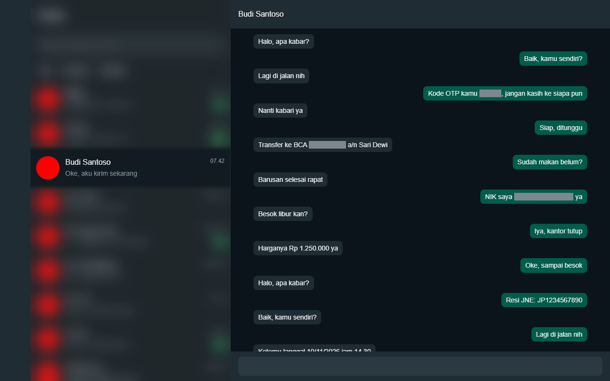
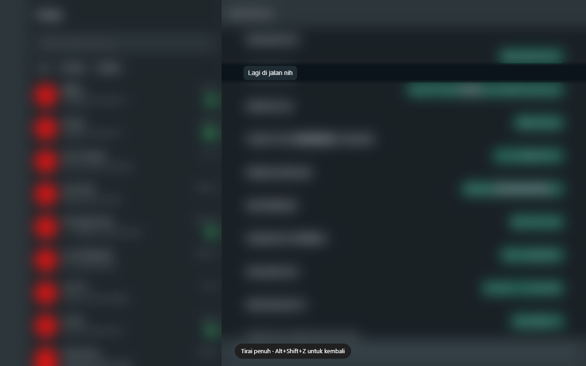
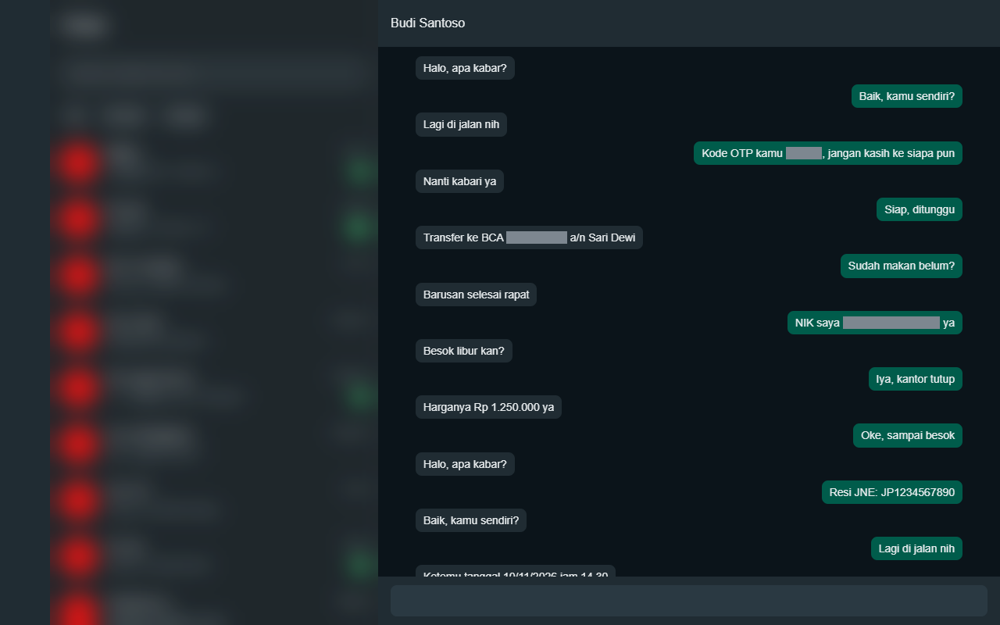

# Tirai

Tirai (Indonesian for "curtain") is a Chrome and Edge extension that hides your WhatsApp Web chats behind a frosted curtain. A small reading lamp follows your cursor, so you can read the one chat or message you point at while everything else stays covered. It is useful when someone can see your screen: in a café, in an office, or in a meeting.



## What it does

- **Normal mode** (the default) covers the chat list. The open chat stays readable.
- **Full mode** covers the whole page. Press `Alt+Shift+Z` to switch between Normal and Full.
- **Reading lamp.** Hold the cursor over a chat row or a message and a clear band opens around just that row or message.
- **Per-chat rule.** For the chat you have open, choose to follow the mode, always hide it, or always show it.
- **Sensitive numbers are masked** even in the chat you are reading: ID numbers (NIK), bank account numbers, card numbers, one-time codes, and phone numbers. E-mail addresses can be switched on. Hover a mask for a moment to read it. Copying still gives the real text.
- **Screen sharing.** If you turn it on, Tirai covers everything while a browser meeting shares your screen, and uncovers it when the share ends.
- **Other triggers.** You can also cover the page when the WhatsApp window is not active, or when you have left the computer.
- **Any tab.** "Cover this tab" in the popup (or `Alt+Shift+Z` on a non-WhatsApp tab) puts the same curtain and masks on a banking or e-mail page, until the page reloads.
- The popup and settings page are in Indonesian and English.





## How it works

Other WhatsApp blur extensions restyle WhatsApp's own elements, and those elements have generated class names that change with every WhatsApp release. Tirai does not touch them. It finds the rectangles of two regions, the chat list and the open chat, and draws a frosted overlay above the page in its own shadow DOM. The overlay does not take clicks, so typing, scrolling, menus and dialogs keep working. If WhatsApp changes its layout, Tirai covers more rather than less. When it cannot find the chat list on a page that is clearly logged in, it covers the whole page and shows a warning in the popup.

- **Reading lamp.** The overlay is split into tiles at the column edges. Each tile has a soft-edged clear band that snaps to the row or message under the cursor.
- **Masks.** Sensitive numbers are found in the visible text and painted with the CSS Custom Highlight API. The page is not changed, so nothing is rewritten and copy and paste still work. The bar is solid, because blurred digits can sometimes be recovered from a recording.
- **Screen-share detection.** On meeting sites you have allowed, Tirai wraps the browser's `getDisplayMedia` call to know when a share starts and ends. It does not look at the meeting itself.
- **Any-tab curtain.** It uses the browser's `activeTab` permission, so Tirai does not need access to all websites.

## How well the number detector works

The detector was measured on a blind test set of 200 synthetic messages. Its test author only had a written brief and never saw the detector code, and the detector was not changed after the measurement.

| Type | Found | Missed | False masks | Precision | Recall |
|---|---|---|---|---|---|
| NIK | 26 | 0 | 0 | 100.0% | 100.0% |
| Card | 25 | 0 | 0 | 100.0% | 100.0% |
| Bank account | 25 | 1 | 0 | 100.0% | 96.2% |
| One-time code | 29 | 1 | 0 | 100.0% | 96.7% |
| Phone | 30 | 0 | 0 | 100.0% | 100.0% |
| E-mail | 12 | 0 | 0 | 100.0% | 100.0% |
| All types | 147 | 2 | 0 | 100.0% | 98.7% |

The messages come from a script with fixed templates and all numbers are synthetic, so real chats, with typos and odd formats, will do worse. [eval/README.md](eval/README.md) explains how the sets were made, how a hit is counted, and the known limits.

## Install

Tirai is not in the Chrome Web Store or Edge Add-ons yet. Store links will be added here.

To use it now:

1. Download or clone this repository.
2. Open `chrome://extensions` (or `edge://extensions`) and turn on Developer mode.
3. Choose "Load unpacked" and select the `extension` folder.
4. Open or reload WhatsApp Web.

## Permissions

| Permission | Why Tirai needs it |
|---|---|
| `https://web.whatsapp.com/*` | To draw the curtain and masks on WhatsApp Web. This is the only access requested at install. |
| `storage` | To keep your settings and chat rules in the browser. |
| `idle` | To cover the page when you leave the computer, if you turn that on. |
| `scripting` | To add Tirai to WhatsApp tabs that were already open at install, to register the screen-share scripts, and to cover another tab on request. |
| `activeTab` | To cover the current non-WhatsApp tab when you ask, without access to all websites. |
| Meeting sites (optional): Google Meet, Zoom, Teams, Discord, Slack, Whereby, Jitsi | Requested only when you turn on "Cover everything while I share my screen". Used only to notice that a share started or ended. Turning the switch off removes the permission. |

## Privacy

Tirai makes no network requests, has no analytics and no account, and keeps everything in your browser. See [docs/privacy.md](docs/privacy.md).

## Limits

- The WhatsApp Desktop app is not covered. A browser extension cannot reach it.
- Tirai is a visual privacy screen. It does not protect you from someone who is using your computer. For that, use WhatsApp's own App Lock, which asks for a password.
- Desktop meeting apps are not detected. If you present from the Zoom or Teams app, turn on "Cover when the WhatsApp window is not active".
- On other tabs, Tirai runs in the top page only. Content inside iframes is not covered, and numbers inside them are not masked.
- If WhatsApp changes its layout so Tirai cannot find the chat list, it covers the whole page and shows a warning. It does not fall back to showing your chats.
- The number detector misses some cases, such as landline numbers and a 4-digit code after the bare word "kode". See [eval/README.md](eval/README.md).

## Development

There is no build step and no runtime dependency. The only dev dependency is `puppeteer-core`.

```
npm ci
npm test            # unit tests and the detector check on the dev set
npm run test:e2e    # browser tests, needs Chrome: set CHROME_PATH if it is not in the default place
npm run eval        # detector evaluation, see eval/README.md
npm run package     # writes dist/tirai-<version>.zip
```

`npm run icons` renders the PNG icons from `extension/icons/icon.svg`, and `npm run screens` regenerates the store screenshots. Set `HEADFUL=1` to watch the e2e tests in a visible browser.

## Not affiliated

Tirai is not affiliated with WhatsApp or Meta. WhatsApp is a trademark of its owner.

## Licence

MIT. See [LICENSE](LICENSE).
